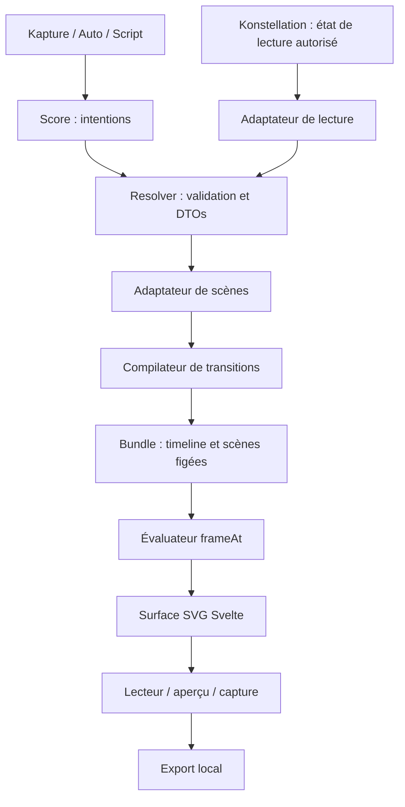
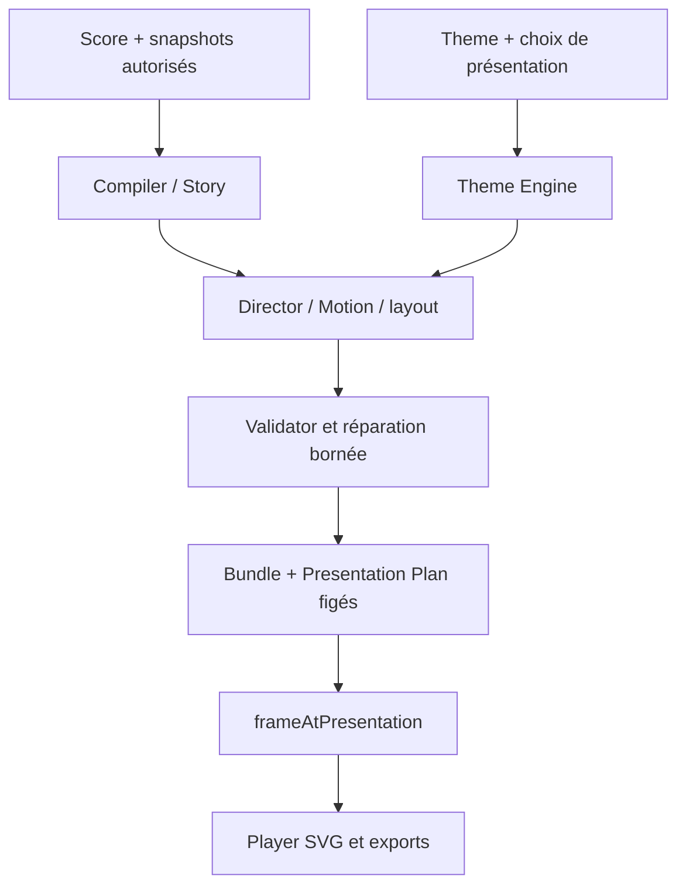

# 01 — Architecture et frontières

## Flux cible

Les flèches décrivent des échanges de données, pas des services réseau à créer. Les boîtes E–I sont des fonctions/modules internes. Le seul fournisseur de faits est le pipeline de lecture de Konstellation. Les exports ne retournent rien au Kristal.

## Frontière des responsabilités

| Module proposé | Entrée | Sortie | Interdit |
|---|---|---|---|
| `reader-adapter` | Contexte actif, intention, abort signal | DTO validé ou diagnostic | Accès direct aux fichiers ou index non filtrés |
| `capture` | Événements sémantiques confirmés | Score | Coordonnées souris, token, journal de hovers |
| `route-planner` | Vue filtrée, objectifs, budgets | Candidats, chemin, raisons | Inférer des relations absentes |
| `resolver` | Score + adaptateur actif | Séquence de snapshots de vue | Tolérer changement silencieux de policy/corpus |
| `scene-adapter` | DTO, locale, thème | Scène graphique normalisée | Inventer un fait à partir du placement |
| `compiler` | Scènes, intention, profil | Bundle validable, transitions et durées | Accès réseau, horloge système, hasard implicite |
| `frame-at` | Bundle + temps en ms | État visuel | Mutation du bundle, effets réseau |
| `player` | État visuel + commandes | SVG et transcription | Réinterpréter les données métier |
| `export` | Bundle, format, profil de sortie | Fichier et manifeste | Publication, secrets, requêtes externes |

## Cycle de vie

`idle → preparing → ready → playing ↔ paused → ended`. `ready/paused/ended` permettent `seek`; `exporting` est une opération séparée utilisant un bundle immuable. Toute erreur de préparation donne `error` (avec reprise explicite), toute annulation donne `cancelled`. Un changement de contexte invalide une préparation, lecture ou export encore en cours, détruit les caches et exige une nouvelle résolution. Une nouvelle opération reçoit un identifiant de génération ; une réponse tardive ne peut pas être attachée à la génération actuelle. Les fichiers déjà remis à l'utilisateur ne sont pas révocables par ce mécanisme.

## Modèle de données à trois niveaux

1. **Score** : intention réutilisable, versionnée, sans coordonnées ni secrets.
2. **Snapshots** : DTOs autorisés et diagnostics de résolution, transitoires, conservés en mémoire le moins longtemps possible. L'adaptateur extrait uniquement les champs utiles.
3. **Bundle** : scènes minimales, identité visuelle, temps, preuves visibles et métadonnées de version. Figé après compilation ; constitue la source de l'aperçu et de l'export.

Un fichier Score ne permet pas de retrouver un contenu sans la source autorisée. Un Bundle contient des données lisibles et doit être considéré comme aussi sensible que celles-ci. Pour l'export, une projection spécifique minimale du Bundle peut être utilisée si elle préserve les informations nécessaires au rendu et à la compréhension.

## Choix de stockage

V0.1 : en mémoire, sauvegarde locale explicite du Score. Aucun stockage navigateur persistant par défaut, aucune migration de base de données. Les données de contexte ne doivent pas passer par URL, analytics, journal d'événements ou stockage partagé. La persistance d'un Bundle est un export explicite, pas un cache silencieux. Éviter IndexedDB et service worker tant que les règles de rétention et de séparation par session ne sont pas revues.

## Isolation

Le lecteur ne prend pas le contrôle du shell de navigation durant la lecture. Kapture observe les événements confirmés ; la démo ouvre une surface dédiée. Fermer la démo restaure simplement l'exploration laissée intacte. La désactivation du flag masque les commandes et évite de lancer tout travail Koreograph.

## Extension de présentation v0.2

Theme Engine résout les tokens ; Story compose les actes factuels ; Director coordonne cadrage et mouvement ; Validator vérifie et corrige en compilation ; aucune boîte n'est un service. Le Plan dépend du Bundle exact, et aucune donnée de thème n'influence le choix de route. La couche de présentation est optionnelle pour la tranche initiale. Voir [contrats](19-production-contracts.md).
